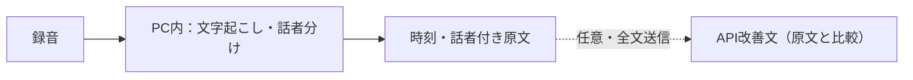
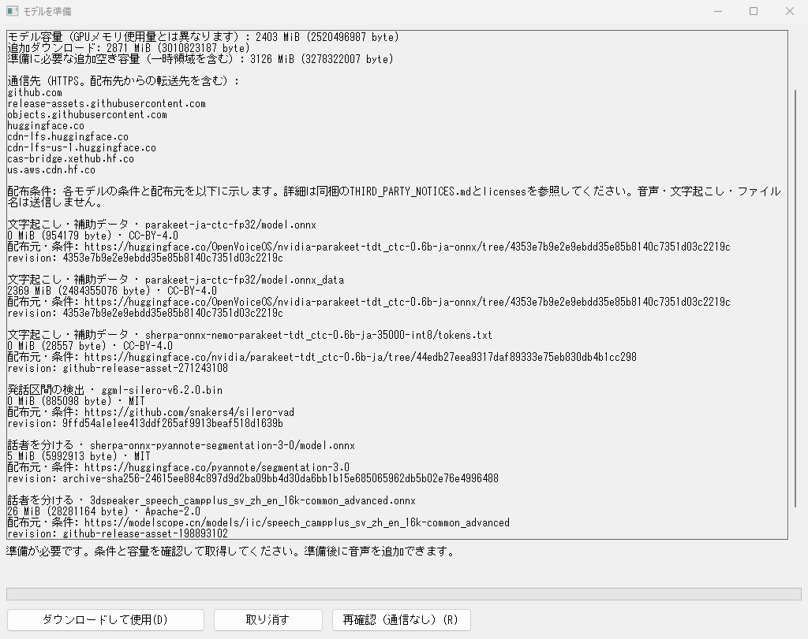
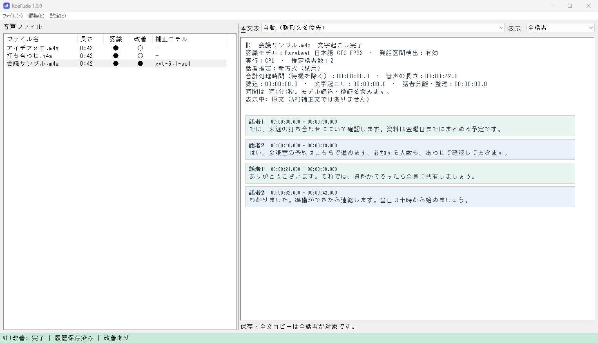
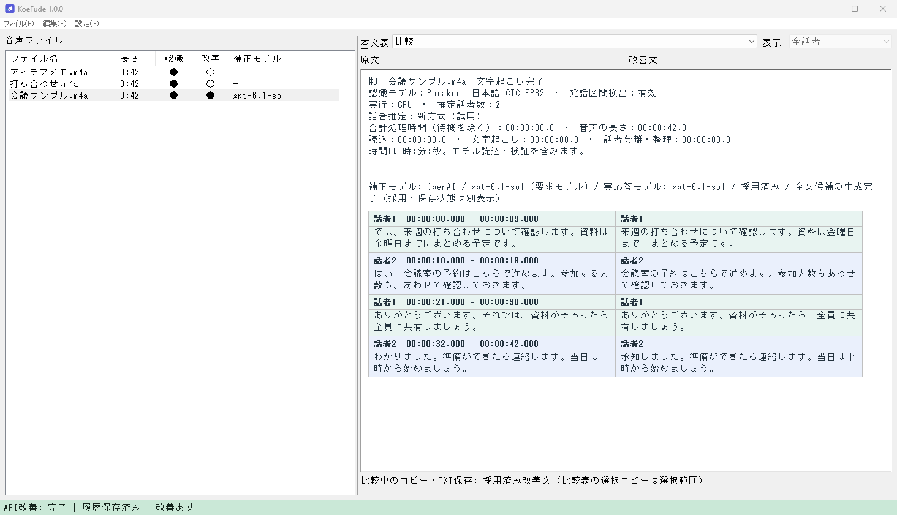
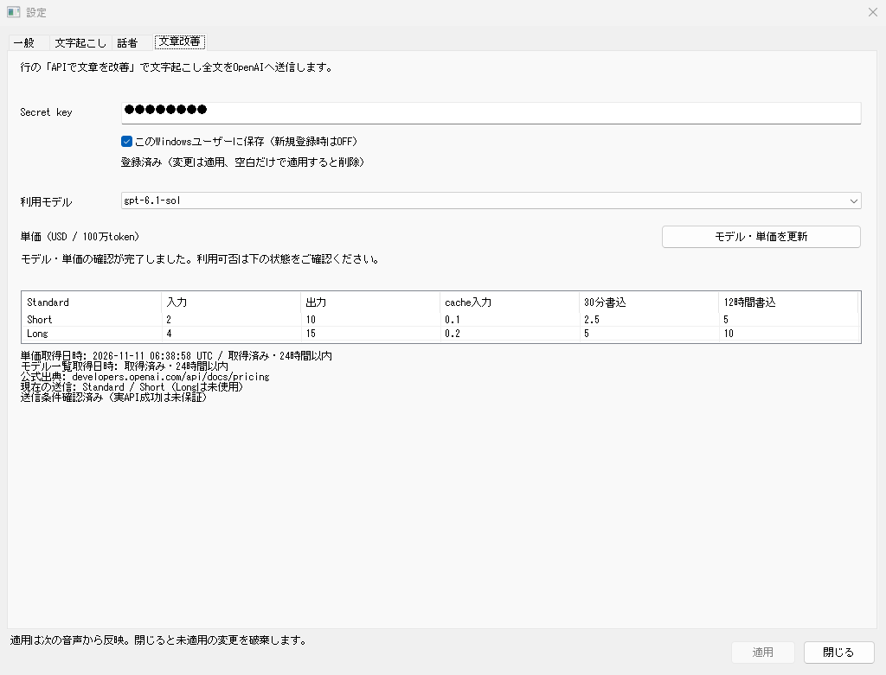

# 🎙️ KoeFude

  

KoeFude（こえふで）は、音声を時刻・話者付きの文章にするWindows 11 x64用アプリです。
会議や打ち合わせの録音を読み返し、必要な文章や字幕として保存できます。
1.0.0は日本語専用で、既定の音声認識と話者分けはPC内で行います。

## ✨ できること

- **音声を追加して文字起こし** — M4A・WAV・MP3・FLACをドラッグするか、ファイル選択から追加できます。複数の音声は順番に処理します。
- **時刻と話者ごとに読み返す** — 発言を話者別の色で表示し、「話者1」などの表示名を変更できます。
- **コピー・字幕保存** — 全文コピーとUTF-8のTXT・SRT・VTTへの保存に対応します。
- **モデル準備後はオフラインでも利用** — 必要なモデルだけ取得して再利用します。既定のParakeetはNVIDIA GPU（CUDA）またはCPUで動作し、Pythonなどの導入は不要です。

認識結果と話者分けは推定です。重要な発言や数値は原音と照らし合わせて確認してください。

## ⚙️ KoeFudeの仕組み

以下は既定のローカルParakeet方式です。モデル準備後は、音声や本文を外部へ送らずにPC内で処理できます。

- 録音を区間ごとに読み取り、Parakeetで文字にします。話者分けは別のモデルで声の特徴を調べ、同じ録音内の話者を推定します。文字と話者の情報を時刻で組み合わせ、原文として表示します。
- 認識は対応するNVIDIA GPU（CUDA）が使えればGPU、使えなければCPUを利用します。話者分けはCPUで行います。
- 任意のAPI文章改善を明示実行するときだけ、全文をOpenAIへ送って整えます。原文は保持され、改善文と並べて比較できます。

## 🚀 はじめて使う

インストーラーとZIP版は[リリース](https://github.com/EnterOgawa/koe-fude/releases/latest)から取得します。

1. インストーラーで導入するか、ZIP版をフォルダーへ一式展開し、`KoeFude.exe`を開きます。
2. 音声を本文欄へドラッグするか、「ファイル → 音声を追加…」（Ctrl+O）で選びます。
3. 左の一覧で音声を選んで結果を読み返し、行の右クリックから「保存…」「全文コピー」「話者名を変更…」を使います。

起動時に取得済みモデルを確認し、準備済みなら音声を追加してそのまま使えます。

### 📦 モデル準備画面が表示されたら

インストーラー・ZIPにモデル本体は含まれていません。必要なモデルが未準備なら初回起動時にも準備画面が開くので、案内に従って取得します。取得せずに閉じて音声を追加すると準備画面が再び開き、未準備のまま処理は始まりません。

1. 用途・容量・必要な空き容量・配布条件・保存先・通信先を確認し、「ダウンロードして使用」を押します。選んだ構成の不足分だけを取得します。
2. 「準備ができました」と表示されたら準備画面を閉じ、もう一度音声を追加します。

別のモデルへ変更する場合は、「設定 → 設定… → 文字起こし」で選んで「適用」します。不足するモデルがあれば準備画面が開きます。

*実アプリのモデル準備画面（未準備のサンプル環境）。*

取得・検証済みのモデルは次回も再利用し、準備後のローカル文字起こしはオフラインで使えます。APIキーは必要ありません。
入力形式の条件や詳しい動作環境は[利用案内](docs/user-guide.md)を参照してください。

*実アプリ画面（サンプルデータ）*

## 📝 文章を読みやすくする

行の右クリックにある任意の「APIで文章を改善」で、文字起こしの文章を整えられます。
この操作は対象の文字起こし全文をOpenAIへ送信し、API利用料がかかります。
改善文を保存した後も原文は保持され、本文の表示を「原文」や「比較」へ切り替えて読み返せます。
比較では左に原文、右に改善文を表示します。

*実アプリ画面（サンプルデータ）。左が原文、右が改善文です。*

音声認識自体にOpenAI音声APIを選ぶこともできます。音声APIは音声区間、文章改善は文字起こし全文を送る別の操作です。いずれも任意の有料機能で、共通のAPIキーを使います。

## 🔑 APIキー（Secret key）を設定する

「Secret key」はOpenAI API用のAPIキーです。API機能を使う場合に設定します。

1. [OpenAIのAPIキー管理](https://platform.openai.com/api-keys)でAPIキー（Secret key）を作成・コピーします。
2. KoeFudeの「設定 → 設定… → 文章改善」を開きます。取得中ダイアログが閉じたら「Secret key」へ貼り付けます。
3. 保存方法を選び、**「適用」でキーを登録**します。キー入力後の適用でモデル・単価の更新も行います。
4. 単価が未取得の場合や一覧を更新したい場合は「モデル・単価を更新」を押します。「利用モデル」を確認・選択し、変更したら「適用」を押します。

キー登録前も対応済みのモデル候補を選べます。モデルの利用資格と有効な単価が確認できるまでは送信できません。取得中の標準ダイアログは、閉じる・Esc・「キャンセル」で情報取得を取り消せます。

「このWindowsユーザーに保存」をONにすると、Windowsの資格情報として保存し、次回起動でも使えます。OFFなら起動中だけ保持します。新規登録時はOFFです。
登録済みキーは固定の伏せ字で表示し、未編集なら保持します。キー設定だけでは音声や本文を送信しません。

*実アプリの設定画面（キーは伏せ字、単価は撮影時点）。*

APIの送信条件、料金表示、キーと履歴の扱いは[通信・保存の説明](docs/privacy.md)にまとめています。

## 📚 詳しい案内

- [導入・使い方・動作環境](docs/user-guide.md)
- [API・通信・履歴の扱い](docs/privacy.md)
- [開発環境とビルド](docs/development.md)

製作者 **Shunji Ogawa** ／ [MIT License](LICENSE) ／ [第三者資産](THIRD_PARTY_NOTICES.md)
